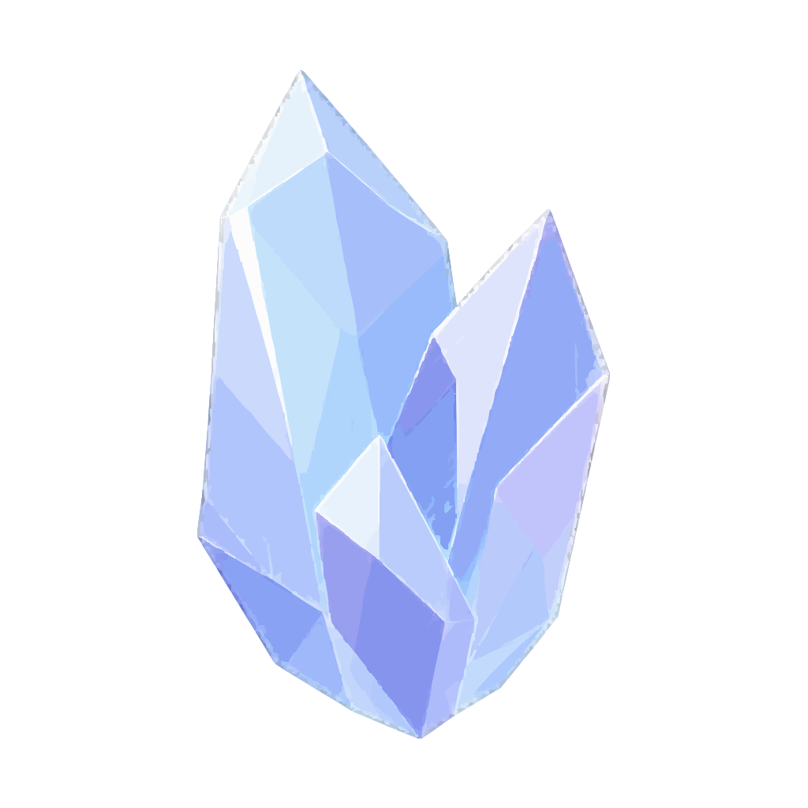
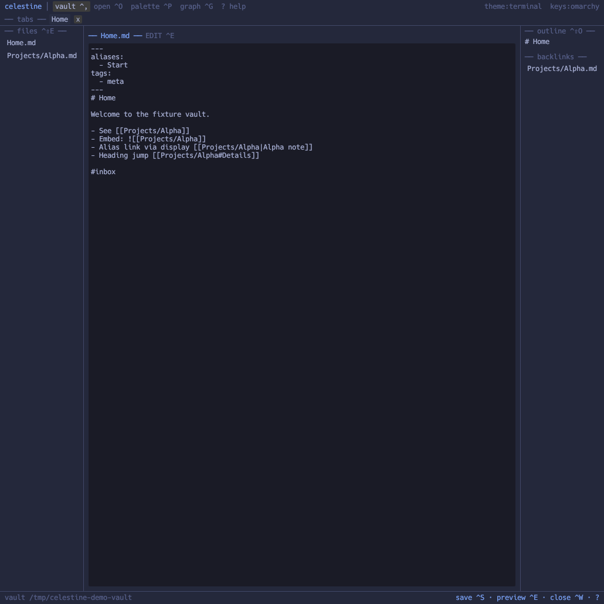
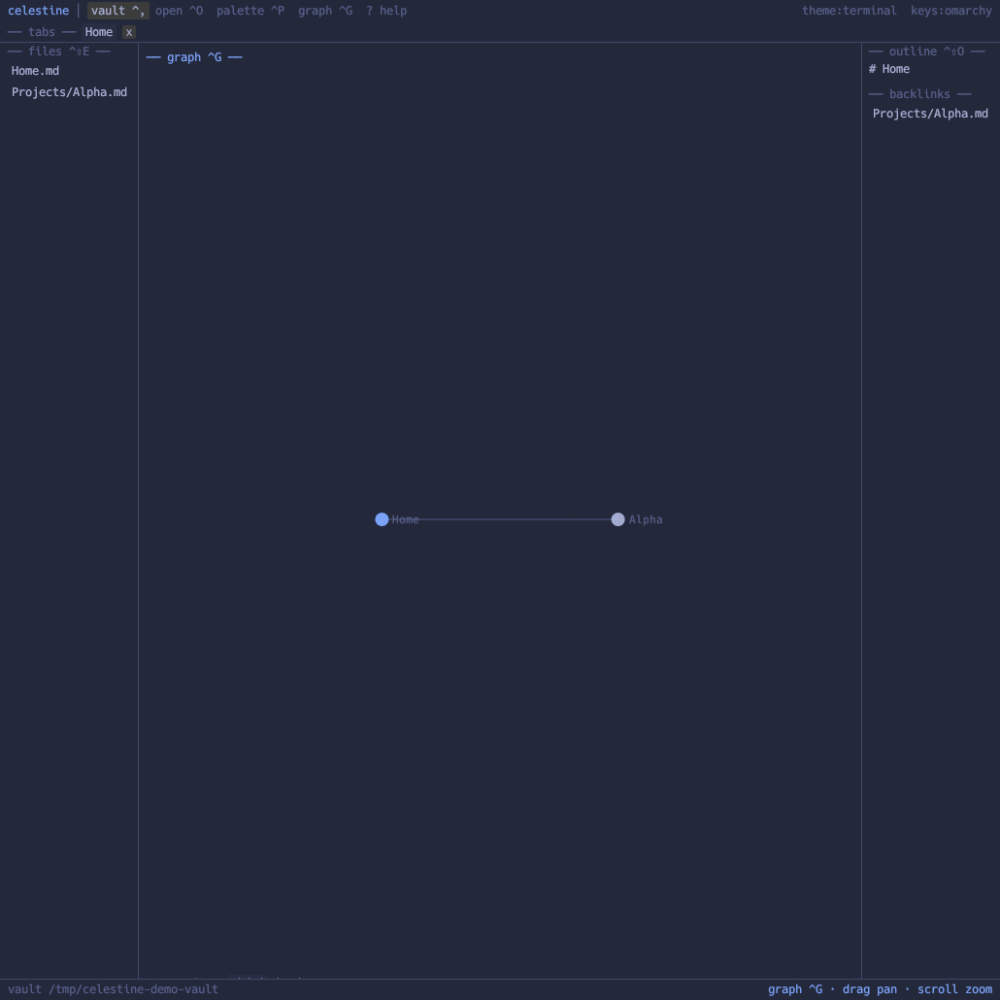
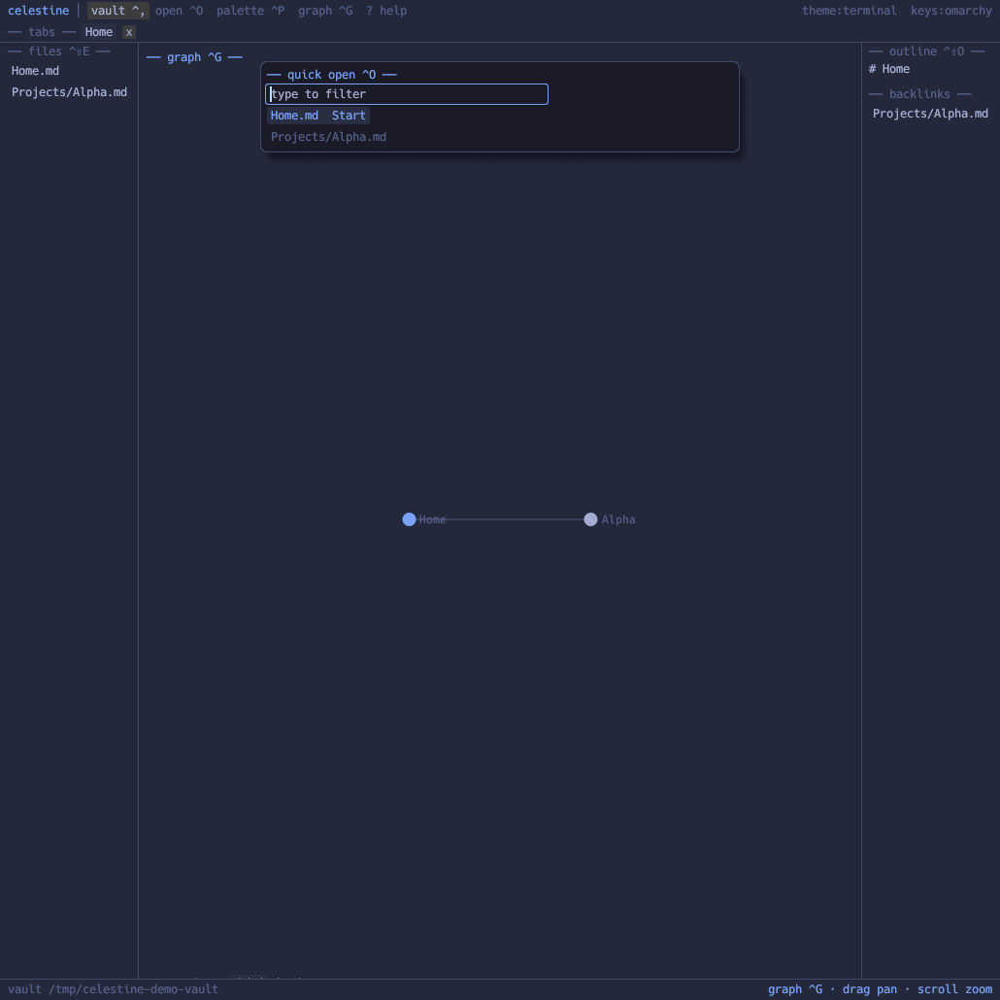
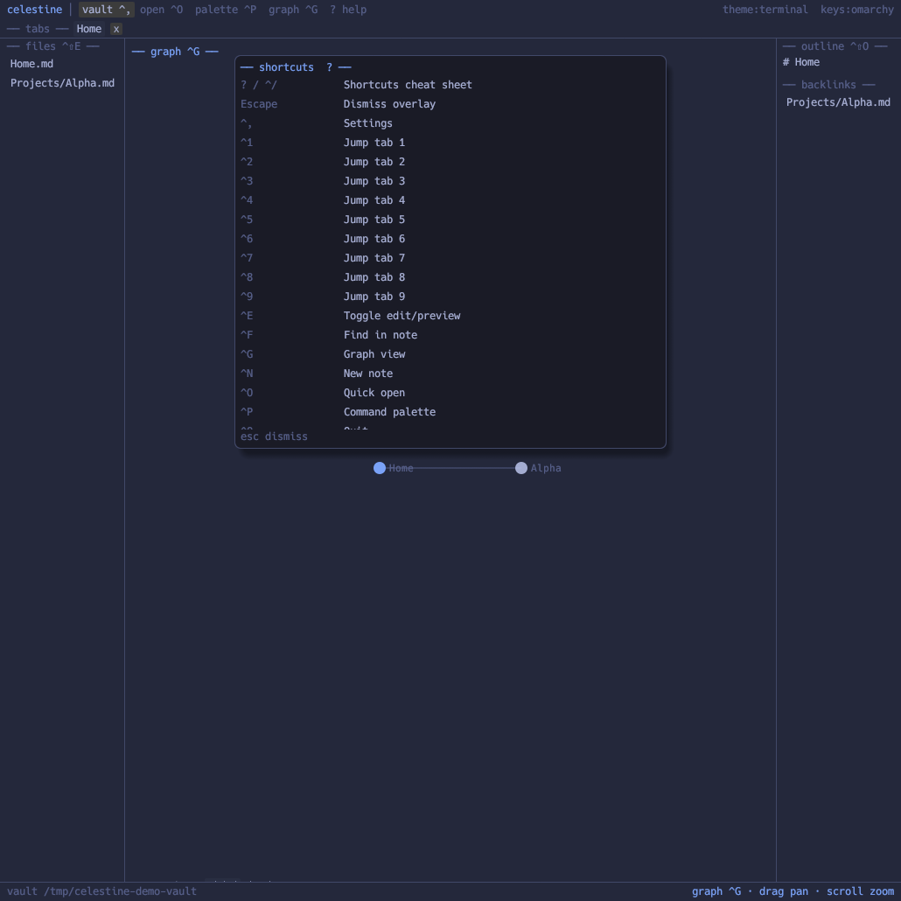
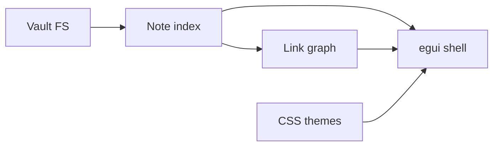

<p align="center">
  
</p>

<h1 align="center">CelestineMD</h1>

<p align="center">
  <strong>Local Markdown notes. Native Rust. Ultralight.</strong>
</p>

<p align="center">
  An open-source knowledge base inspired by Obsidian — wikilinks, graph, backlinks,<br/>
  and a terminal-honest UI that stays out of your way.
</p>

<p align="center">
  <a href="#install"></a>
  <a href="#features"></a>
  <a href="docs/INSPIRATION.md"></a>
  <a href="#license"></a>
  
  
</p>

<p align="center">
  <a href="#why-celestine">Why</a> ·
  <a href="#features">Features</a> ·
  <a href="#install">Install</a> ·
  <a href="#keyboard-first">Shortcuts</a> ·
  <a href="#themes">Themes</a> ·
  <a href="#architecture">Architecture</a> ·
  <a href="docs/INSPIRATION.md">Inspiration</a>
</p>

---

<p align="center">
  
</p>
<p align="center"><sub>Edit mode — files, outline, backlinks, shortcut chrome</sub></p>

<p align="center">
  
</p>
<p align="center"><sub>Graph view — notes as a link map</sub></p>

<p align="center">
  
</p>
<p align="center"><sub>Quick open (<code>Mod+O</code>) — fuzzy file switcher</sub></p>

<p align="center">
  
</p>
<p align="center"><sub>Shortcuts cheat sheet (<code>?</code>)</sub></p>

---

## Why Celestine?

Most note apps either ship Electron bloat or lock you into a proprietary store.

**CelestineMD** is a small native app inspired by the Obsidian workflow — not a rewrite of it:

| | |
|---|---|
| **Your vault stays yours** | Plain Markdown on disk. Open any folder of notes. |
| **Native & fast** | Pure Rust (`egui`/`eframe`) — no Chromium tax. |
| **Inspired, not cloned** | Familiar ideas (wikilinks, graph, backlinks); Celestine’s own UI and scope. |
| **Keyboard-native** | Shortcuts printed on the UI. Learn by looking. |
| **Honest UI** | Terminal/ASCII chrome. No ribbon farm. No plugin bazaar (by design, v0.1). |

---

## Features

### Core knowledge loop
- **File browser** with vault folders
- **Fuzzy quick open** — `Ctrl/Cmd+O`
- **Command palette** — `Ctrl/Cmd+P`
- **Wikilinks** `[[Note]]`, aliases, heading jumps, embeds `![[…]]`
- **Outline** from headings
- **Backlinks** pane
- **Graph view** — `Ctrl/Cmd+G` (global + local)
- **Edit + reading preview** — `Ctrl/Cmd+E`
- **Vault search** — `Ctrl/Cmd+Shift+F`

### Themes & keys
- Built-in **CSS custom-property** packs (`tokyo-night`, `catppuccin`, `nord`, `gruvbox`, …)
- **`terminal`** theme follows [Omarchy](https://omarchy.org) `colors.toml` when present
- Remappable TOML keybindings — Obsidian + Omarchy-friendly profiles

### What v0.1 deliberately skips
Plugins · Canvas · Sync · Live Preview WYSIWYG · loading arbitrary community `theme.css` engines

---

## Install

### From source

```bash
git clone https://github.com/celestinemd/celestine.git
cd celestine
cargo run -p celestine-app --release -- /path/to/vault
```

### Linux (user install)

```bash
cargo build -p celestine-app --release
./packaging/install-user.sh
```

This installs the binary, `celestine.desktop`, and hicolor icons from `assets/icon/` (PNG sizes + scalable SVG). Then launch **CelestineMD** from your app menu, or:

```bash
celestine ~/Notes
```

### Requirements
- Rust stable toolchain  
- Linux: usual OpenGL / Wayland or X11 libs for `eframe`  
- macOS / Windows: same `cargo` build (cross-platform GUI)

```bash
cargo test --workspace
```

---

## Keyboard-first

Mod = **Ctrl** on Linux/Windows, **Cmd** on macOS.

| Shortcut | Action |
|----------|--------|
| `Mod+O` | Quick file open |
| `Mod+P` | Command palette |
| `Mod+G` | Graph view |
| `Mod+T` | Theme picker |
| `Mod+Shift+O` | Open vault |
| `Mod+R` | Recent vaults |
| `Mod+Shift+W` | Close vault |
| `Mod+=` / `Mod+-` | Larger / smaller Markdown font |
| `Mod+0` | Reset Markdown font |
| `Mod+W` | Close tab |
| `Mod+E` | Toggle edit / preview |
| `Mod+S` | Save |
| `Mod+N` | New note |
| `Mod+Shift+F` | Search vault |
| `Mod+,` | Settings |
| `?` / `Mod+/` | Shortcuts cheat sheet |

**Omarchy profile** (default when Omarchy is detected): `Ctrl+Tab` cycle tabs, `Ctrl+1..9` jump tab, `Ctrl+Shift+E` files, `Ctrl+Shift+O` outline — without stealing Hyprland’s `Super` binds.

Remap: copy [`config/keybindings.omarchy.toml`](config/keybindings.omarchy.toml) → `~/.config/celestine/keybindings.toml`.

---

## Themes

Ship-ready packs in [`themes/`](themes/):

`obsidian-dark` · `obsidian-light` · `catppuccin` · `tokyo-night` · `gruvbox-dark` · `gruvbox-light` · `nord` · `solarized-dark` · `solarized-light` · `dracula` · `rose-pine` · `everforest-dark` · **`terminal`**

```bash
CELESTINE_THEME=nord celestine ~/Notes
```

Themes are **CSS custom properties** (`--background-primary`, …) parsed into UI tokens — editable, portable, no Electron required.

<p align="center">
  
</p>

---

## Architecture

```
celestine/
├── crates/celestine-core/     # vault, parse, index, resolve, graph
├── crates/celestine-theme/    # CSS-var packs + Omarchy bridge
├── crates/celestine-app/      # egui desktop shell
├── themes/                    # built-in *.css
├── config/                    # default keybinding profiles
└── assets/icon/               # crystal mark (SVG + PNG sizes)
```



---

## Inspiration

CelestineMD is an open-source variation **inspired by** Obsidian — local Markdown vaults, wikilinks, graph, backlinks — with its own Rust/egui implementation and feature set. Not affiliated with Obsidian.

Details: [`docs/INSPIRATION.md`](docs/INSPIRATION.md).

---

## Contributing

Issues and PRs welcome. Keep changes focused; match the ultralight / keyboard-first tone.

1. `cargo test --workspace`  
2. Don’t add plugin-host surface area without an explicit RFC  
3. Prefer Celestine’s own design over chasing Obsidian feature parity  

---

## License

[MIT](LICENSE) — free as in crystal-clear.

---

<p align="center">
  <sub>Built for people who love their Markdown vaults and hate waiting for Chromium to boot.</sub>
</p>
